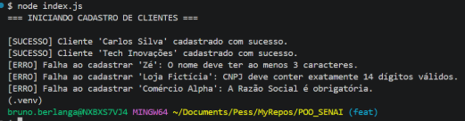
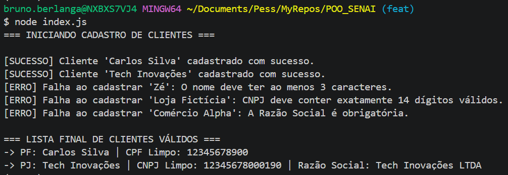

# POO_SENAI
## Appfull - Cadastro de Clientes (E-commerce)

**Estudante:** Bruno Fordelone Berlanga

**Disciplina:** Programação Orientada a Objetos (POO) Senai

## Sobre o Projeto
Este projeto implementa o módulo de cadastro de clientes para a empresa de e-commerce Electronic. O código foi desenvolvido em JavaScript aplicando os pilares da Orientação a Objetos (Herança, Encapsulamento e Abstração), garantindo a integridade dos dados por meio de validações em métodos *setters* e campos privados.

## Como Executar
1. Certifique-se de ter o [Node.js](https://nodejs.org/) instalado na máquina.
2. Clone este repositório.
3. Abra o terminal na pasta do projeto e execute o comando:
   ```bash
   node index.js

## Logs de Execução - Evidências de Testes
## #1

## #2
